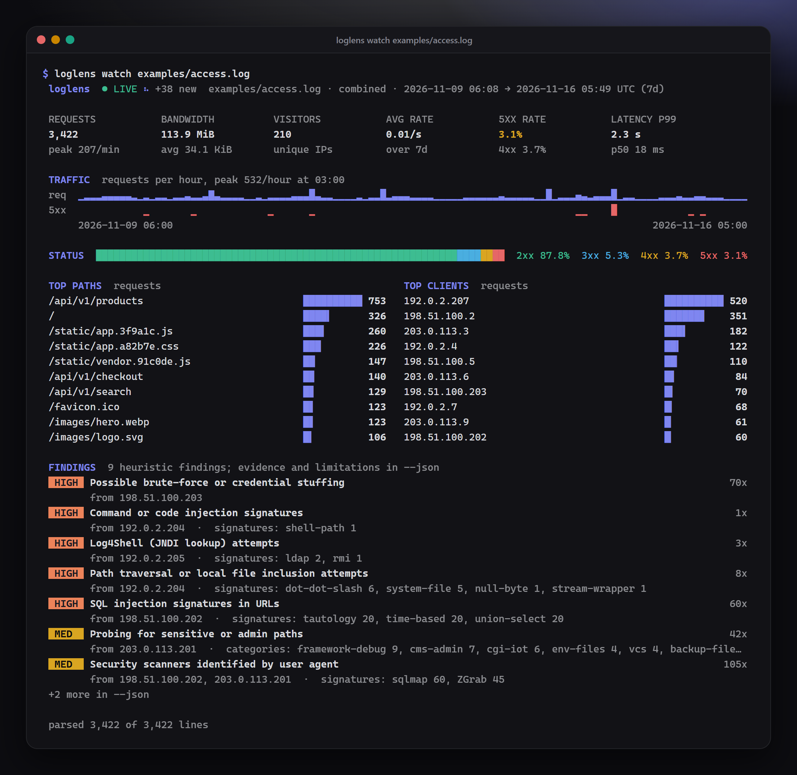
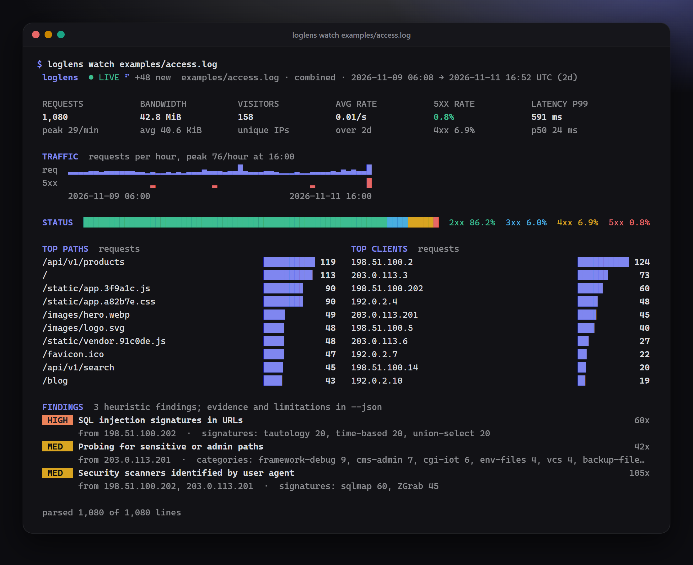
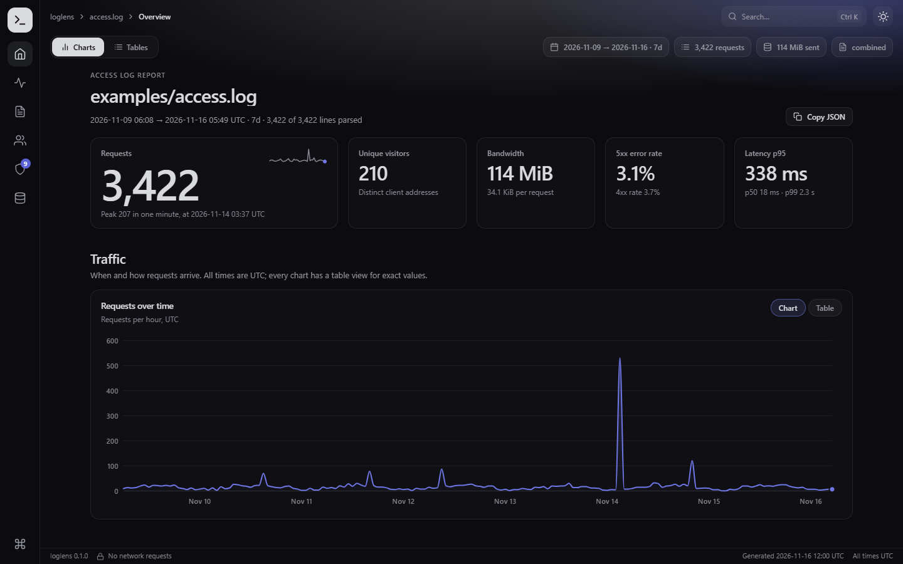
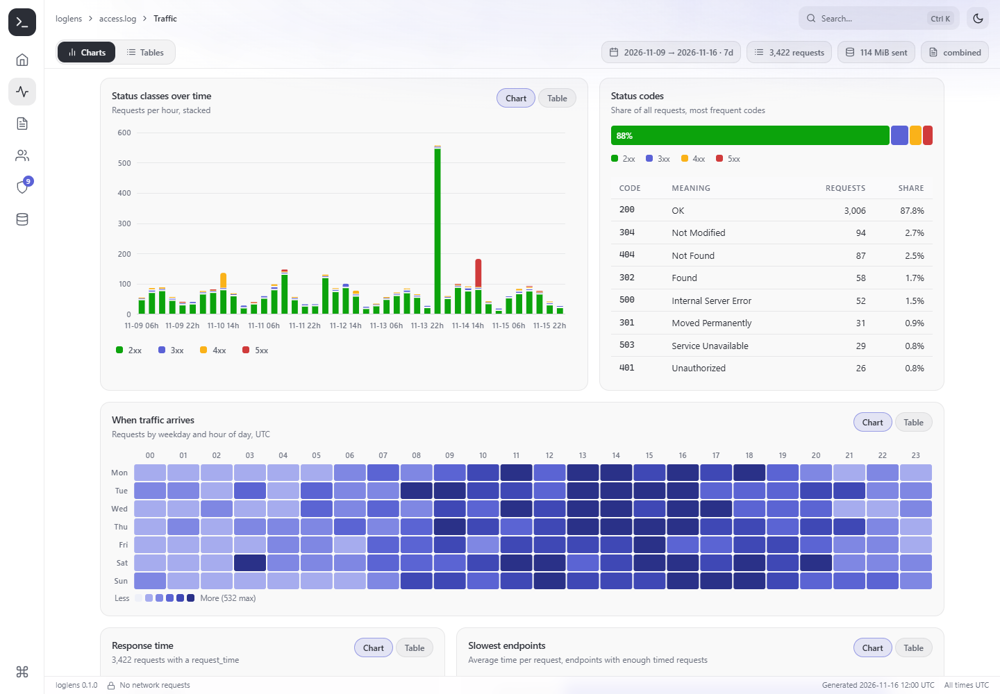
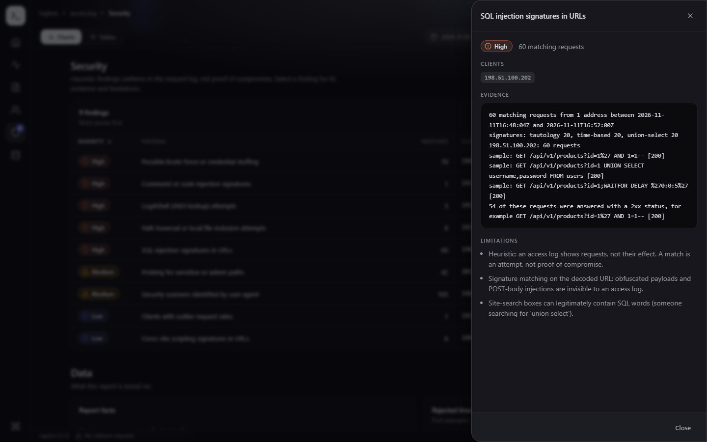
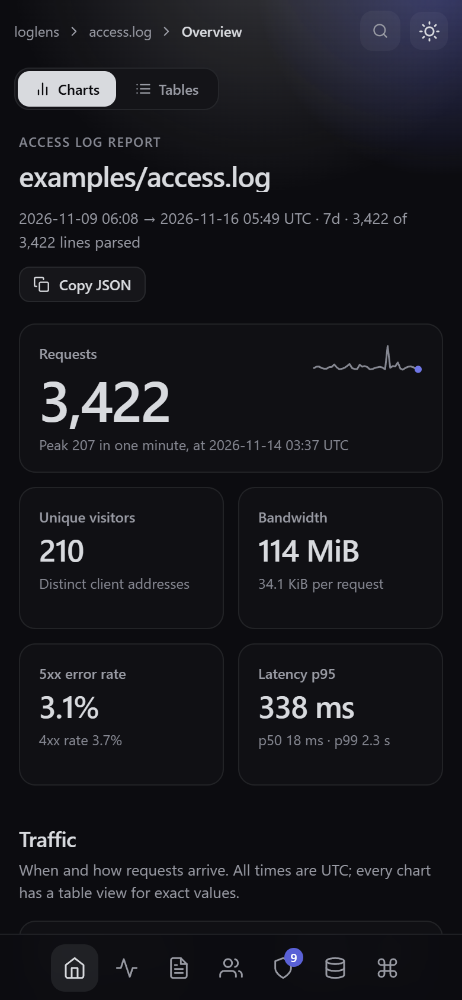
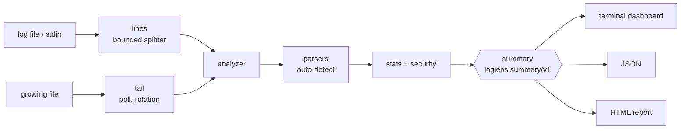

<p align="center">
  
</p>

**loglens turns nginx, Apache and Caddy access logs into a live terminal dashboard, a JSON summary and a single-file HTML report, in pure Lua with no dependencies.**

[](https://www.lua.org/)
[](LICENSE)
[](#why-loglens)
[](https://github.com/q6r/loglens/actions/workflows/ci.yml)

**English** · [Português](README.pt-BR.md)



## Why loglens

- **One command answers "what is happening on my server".** Point it at a log and read traffic, errors, latency percentiles, who is asking and what looks hostile. No agent, no database, no setup.
- **Hostile input is the normal case.** Log text is escaped before it reaches a terminal or a browser, a 10 GB line cannot exhaust memory, and memory use depends on the configuration, not on the size of the log.
- **One analysis, three outputs.** A dashboard for people, a stable JSON schema for scripts and CI gates (`--fail-on high`), and one HTML file that works offline and makes no network request.

## Features

- **Formats:** nginx and Apache *combined* and *common*, JSON lines, Caddy v2; detected automatically, tolerant of IPv6, escaped quotes, truncated lines and binary garbage ([formats](docs/formats.md)).
- **Live mode:** `loglens watch` follows a growing file or standard input and redraws an animated dashboard at a steady rate; it detects log rotation, fits the terminal height and restores the terminal on exit.
- **Numbers you can trust:** exact counters, Space-Saving sketches for rankings, exact-then-HyperLogLog unique visitors, per-minute and per-hour timelines, p50/p90/p95/p99 latency from a log-bucket histogram, 5xx spike detection.
- **Security heuristics with evidence and limits:** path probing, path traversal, SQL injection, XSS, command injection, Log4Shell, scanner user agents, brute force, request-rate outliers. Each finding says what matched and what it cannot see ([heuristics](docs/security-heuristics.md)).
- **HTML report:** one offline file laid out like an app (navigation rail, breadcrumbs, view switch, status bar) with the bundled Aurora UI kit; dark and light themes, a command palette, a chart or table view for every chart, scripts and styles pinned by SHA-256 in a Content-Security-Policy.
- **Scriptable:** `json` output with a documented, deterministic schema ([schema](docs/json-output.md)), a time window, `--top`, stdin as `-`, exit status for CI.

## Quick start

You need Lua 5.3 or 5.4 (`lua -v`). There is nothing to install.

```console
git clone https://github.com/q6r/loglens.git
cd loglens
lua spec/run.lua                                   # optional: the test suite
lua bin/loglens report examples/access.log         # dashboard in the terminal
lua bin/loglens html examples/access.log -o report.html
lua bin/loglens json examples/access.log -o summary.json
lua bin/loglens watch /var/log/nginx/access.log    # live, Ctrl+C to stop
```

On Windows use `bin\loglens.cmd report examples\access.log` (or `lua bin\loglens ...`). With LuaRocks, `luarocks make` installs a `loglens` command (see the note on the rockspec under [Testing](#testing)).

`examples/` holds a week of synthetic traffic for a small shop (with a scanner, a brute-force run, injection attempts and a checkout outage hidden in it) in four formats, the JSON summary and the HTML report built from it. Regenerate them with `lua tools/gen_examples.lua`.

## Usage

```
loglens [report] [options] <file|->...    dashboard for a finished log (the default command)
loglens json     [options] <file|->...    machine-readable summary (schema loglens.summary/v1)
loglens html     [options] <file|->...    self-contained HTML report (works offline)
loglens watch    [options] <file|->       follow a growing log and redraw the dashboard live
loglens formats                           list the supported log formats
loglens version                           print the version
```

The full reference, with every option and the exit status, is in [docs/usage.md](docs/usage.md).

### Dashboard

```console
$ lua bin/loglens report examples/access.log --top 5 --no-color --width 100
 loglens  examples/access.log · combined · 2026-11-09 06:08 → 2026-11-16 05:49 UTC (7d)

 REQUESTS        BANDWIDTH       VISITORS        AVG RATE        5XX RATE        LATENCY P99
 3,422           113.9 MiB       210             0.01/s          3.1%            2.3 s
 peak 207/min    avg 34.1 KiB    unique IPs      over 7d         4xx 3.7%        p50 18 ms

 TRAFFIC  requests per hour, peak 532/hour at 03:00
 req  ▁▁▂▂▂▂▂▂▁▁▁▁▁▂▂▂▂▂▅▂▁▂▂▁▁▁▂▁▂▂▃▂▆▂▂▁▁▁▁▁▂▁▆▂▂▂▂▂▂▁▁▁▁▁▂▂▂▂▃▁▂▁▁▁▁█▁▂▂▃▃▂▂▂█▁▁▁▁▁▁▂▂▂▂▂▂▂▂▂▁▁▁
 5xx           ▁      ▁         ▁     ▁                                    ▁▁   █          ▁▁
      2026-11-09 06:00                                                             2026-11-16 05:00

 STATUS  ███████████████████████████████████████████▓▓▓▒▒░  2xx 87.8%  3xx 5.3%  4xx 3.7%  5xx 3.1%

 TOP PATHS  requests                               TOP CLIENTS  requests
 /api/v1/products                 ██████████ 753   192.0.2.207                       ██████████ 520
 /                                ████▍      326   198.51.100.2                      ██████▊    351
 ...
 FINDINGS  9 heuristic findings; evidence and limitations in --json
 [HIGH] Possible brute-force or credential stuffing                                             70x
        from 198.51.100.203
 [HIGH] Command or code injection signatures                                                     1x
        from 192.0.2.204  ·  signatures: shell-path 1
 ...
```

Colour is used when the output is a terminal; `--color always`, `--no-color`, `NO_COLOR` and `FORCE_COLOR` override it. `--ascii` replaces the block characters, `--width` fixes the width (40 to 240).

### Live mode

`loglens watch` reads what the file already holds, then follows it. The header shows an animated LIVE marker, a spinner and how many lines arrived during the last second. A big backlog is read in slices between redraws, so the numbers climb on screen instead of the dashboard freezing; a rotated log is picked up from its start; when the dashboard is taller than the terminal, the least important lists are left out first.



*Real frames of `loglens watch examples/access.log` from start to end of the sample (regenerate with `lua tools/make_recording.lua`). The hero image at the top is the last frame, and with reduced motion enabled the recording shows only that frame.*

<details>
<summary>A still from the same run, about a third of the way through</summary>



</details>

`tail -f access.log | loglens watch -` reads standard input; `--interval`, `--frames N` (stop after N frames) and `--new-only` (skip what the file already holds) are in the [reference](docs/usage.md#watch-mode).

### JSON and CI gates

The summary is deterministic: the same log gives the same bytes, and `SOURCE_DATE_EPOCH` pins the one timestamp (`meta.generatedAt`) that would otherwise be the current time.

```console
$ SOURCE_DATE_EPOCH=1794830400 lua bin/loglens json examples/access.log --top 3
{
  "schema": "loglens.summary/v1",
  "meta": {
    "tool": "loglens",
    "version": "0.1.0",
    "generatedAt": "2026-11-16T12:00:00Z",
    "sources": ["examples/access.log"],
    "format": "combined",
    "autoDetected": true,
    ...
```

`--fail-on SEVERITY` exits with status 3 when a finding reaches that severity; the report is still written:

```console
$ lua bin/loglens json examples/access.log --compact --fail-on high > summary.json
loglens: 5 findings at or above 'high'
$ echo $?
3
```

Mistakes are explained, with suggestions:

```console
$ lua bin/loglens report examples/access.log --formt json
loglens: unknown option '--formt'. Did you mean '--format'? (see 'loglens report --help')
$ lua bin/loglens jsn examples/access.log
loglens: unknown command 'jsn'. Did you mean 'json'?
$ lua bin/loglens report nope.log
loglens: nope.log: No such file or directory
```

Exit status: `0` ok, `1` failure (unreadable input, or no line could be parsed), `2` usage error, `3` `--fail-on`, `130` interrupted.

### HTML report

```console
$ lua bin/loglens html examples/access.log -o report.html
loglens: wrote report.html (253.3 KiB)
```

One file, no server, no network. It opens from `file://` and is laid out like an app: a rail with one destination per section (overview, traffic, content, clients, security, data) that follows your scroll, breadcrumbs, a Charts / Tables switch (every chart also has its own table view), a command palette (`Ctrl+K`), dark and light themes and a status bar. On a phone the rail moves to the bottom of the screen. Select a finding to see its evidence and limitations.



| Light theme | A finding with its evidence | On a phone |
|---|---|---|
|  |  |  |

### As a library

Everything the CLI does is available as plain Lua modules:

```lua
local analyzer = require("loglens.analyzer")

local summary = analyzer.analyze_lines(io.lines("examples/access.log"), { top = 5 })
print(summary.totals.requests, summary.findings[1].severity, summary.findings[1].title)
--> 3422    high    Possible brute-force or credential stuffing
print(#summary.paths, summary.paths[1].path, summary.paths[1].count)
--> 5       /api/v1/products        753

local page = require("loglens.render.html").render(summary)   -- the HTML report as a string
```

`analyzer.new(opts)` gives an object with `feed(line)` and `summary()` for streaming use; `summary()` can be called at any time. The result is documented in [docs/json-output.md](docs/json-output.md).

## Architecture



Parsers produce records, the analyzer folds them into bounded-memory sketches and detectors, and renderers turn the resulting summary into text, JSON or HTML; they never see the log. Everything that touches the outside world (files, clock, sleep, terminal) is passed in, so the CLI and the live loop are tested with fakes. Details and the memory bounds are in [docs/architecture.md](docs/architecture.md).

## Project layout

```
bin/loglens              entry point (bin/loglens.cmd for Windows)
src/loglens/
  cli.lua, args.lua      commands, option parsing, exit status
  watch.lua, tail.lua    live loop and file/stream sources
  lines.lua              bounded-memory line splitter
  platform.lua           the only code that touches the OS (terminal, sleep, environment)
  analyzer.lua           streaming pipeline: detect, parse, window, count, detect attacks
  parser/                combined/common, JSON lines, Caddy
  stats.lua, security.lua, agents.lua, topk.lua, hll.lua, histogram.lua
  summary.lua            schema id, validator, canonical JSON
  render/terminal.lua    summary -> text (pure function)
  render/html.lua        summary -> single-file report
  assets/                bundled Aurora UI kit (aurora*.css/js) + report.js/report.css
spec/                    specs (undeclared globals are errors), golden frames in spec/fixtures/golden
tools/                   loggen.lua (synthetic logs), gen_examples.lua, make_recording.lua
examples/                sample logs, summary.json, report.html
docs/                    architecture, formats, security-heuristics, json-output, usage, screenshots
```

## Configuration

Command-line options (all in [docs/usage.md](docs/usage.md)):

| Option | Default | Meaning |
|---|---|---|
| `-f, --format` | `auto` | `combined`, `common`, `json` or `caddy` |
| `--from`, `--to` | none | time window, ISO 8601 or epoch seconds |
| `-n, --top` | `10` | rows per ranked list (1 to 100) |
| `--color`, `--no-color`, `--ascii`, `--width` | auto | terminal rendering |
| `-o, --output`, `--compact` | stdout | where and how `json` and `html` write |
| `--fail-on` | off | exit with status 3 at this severity or above |
| `--interval`, `--frames`, `--new-only` | `0.25`, endless, off | watch mode |

| Environment | Effect |
|---|---|
| `NO_COLOR`, `FORCE_COLOR`, `TERM=dumb` | colour on or off |
| `COLUMNS`, `LINES` | terminal size when the shell exports it |
| `SOURCE_DATE_EPOCH` | fixes `meta.generatedAt` for reproducible output |
| `LOGLENS_DEBUG` | stack traces for unexpected errors |

Library options of `analyzer.new`: `format` (`"auto"`), `top` (10), `from`, `to`, `sources`, `now`, `max_line_bytes` (65,536), `malformed_samples` (5), `detect_lines` (10), plus `stats` (capacities, bucket counts, accuracy) and `security` (thresholds, see [heuristics](docs/security-heuristics.md#thresholds)) tables.

## Security notes

- **Logs are untrusted.** Paths, user agents and evidence lines go through `util.defang`: control characters, invalid UTF-8 and bidirectional or invisible code points are written as `\xNN` or `\uXXXX`, and `< > " ' ` $ { } \` are percent-encoded. A hostile request cannot inject terminal sequences, markup or shell syntax into a report.
- **The HTML report cannot be hijacked by log content.** Data travels as a JSON island with `<`, `>`, `&`, U+2028 and U+2029 escaped, every string is drawn with `textContent`, and a `Content-Security-Policy` (`default-src 'none'`, scripts and styles pinned by SHA-256) means injected markup could neither run nor reach the network. The specs push `</script>` and U+2028 through the renderer.
- **Bounded resources.** A line is capped at 64 KiB while it is read (the one exception is `watch -`, which reads standard input line by line), rankings and per-client state live in fixed-size sketches, timelines keep a fixed number of buckets, and `--output` refuses to overwrite its own input.
- **Nothing is executed and nothing leaves the machine.** loglens makes no network request, writes only the file you name, and never evaluates log content. Its only subprocesses are `sleep`, `stty` and `[ -t 1 ]` (POSIX) or `mode con` (Windows), used for terminal handling and guarded so that a failure degrades to defaults.
- **Findings are heuristics.** They report attempts, not compromises, and each states its limitations. A 2xx answer to an attack does not prove it worked.

Report vulnerabilities privately as described in [SECURITY.md](SECURITY.md).

## Testing

```console
$ lua spec/run.lua
loglens spec runner (Lua 5.4)
...
390 tests, 90481 assertions, 0 failures
```

Parsers, sketches and the JSON codec have property and fuzz tests with seeded generators; terminal frames are compared with golden files (`UPDATE_GOLDEN=1 lua spec/run.lua` rewrites them: read the diff); the CLI, the watch loop, log rotation, colour and width decisions and the HTML escaping run against fake files, clocks and terminals. CI is set up to run the suite on Lua 5.3 and 5.4, luacheck, a smoke test of the commands and a check that the committed examples are current.

What the specs cannot cover on their own: reading a real terminal (size, isatty), a real `tail -f` against another process, Windows consoles, and installation with LuaRocks (the rockspec is written but was not built where this was developed). Those paths sit behind small hooks (`platform.lua`) that the specs fake.

## Roadmap

- Compressed logs (`.gz`) without `zcat`.
- More formats: HAProxy, Traefik, AWS load balancers.
- `--anonymize` to hash client addresses in shared reports.
- Compare two periods, and a Prometheus-style export.
- Keyboard control in watch mode (pause, sort, drill into a finding) where a non-blocking terminal is available.

## Contributing

Issues and pull requests are welcome. [CONTRIBUTING.md](CONTRIBUTING.md) covers setup, the test suite, linting and commit style.

## License

[MIT](LICENSE) © 2026 q6r

## Credits

The HTML report is built with the Aurora UI kit, bundled in `src/loglens/assets/` (zero dependencies, MIT, part of this repository). The sketches follow the Space-Saving algorithm (Metwally, Agrawal and El Abbadi) and HyperLogLog (Flajolet and others); outliers use the modified z-score of Iglewicz and Hoaglin. [GoAccess](https://goaccess.io/) is the established tool in this space and a good reference: loglens is independent and narrower, aimed at a zero-install dashboard, a scriptable summary and security triage.
