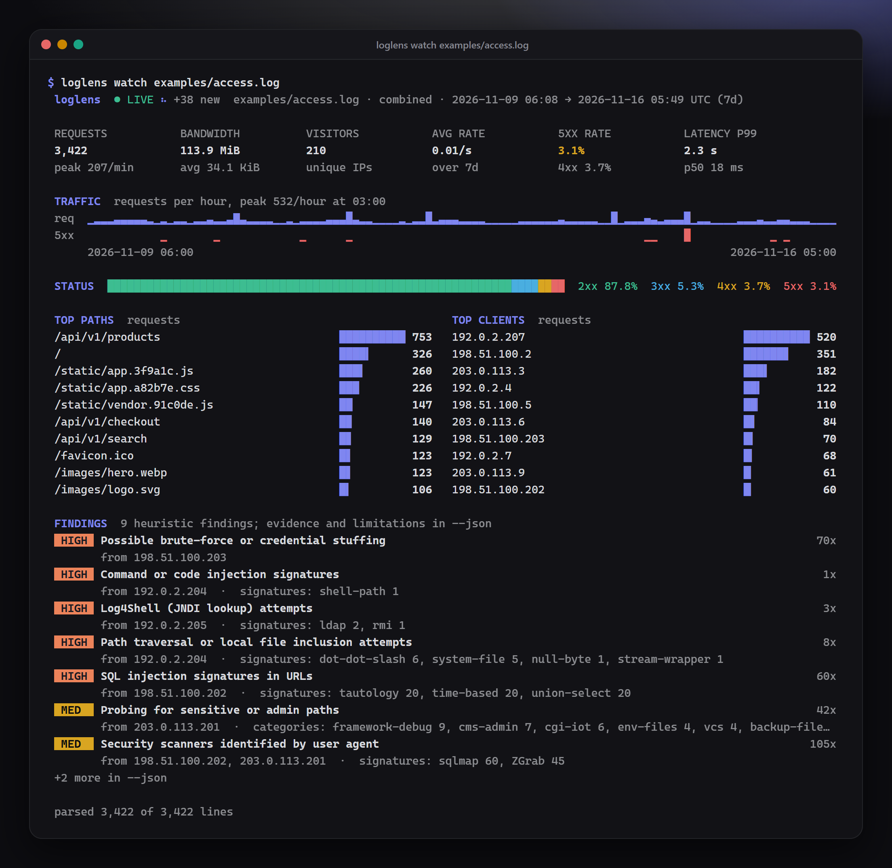
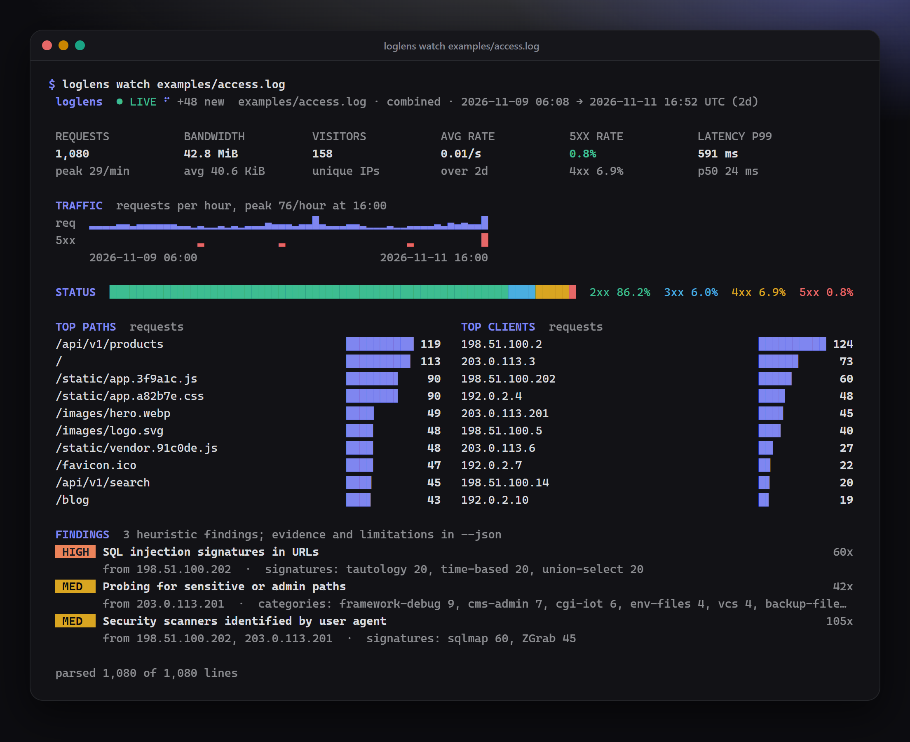
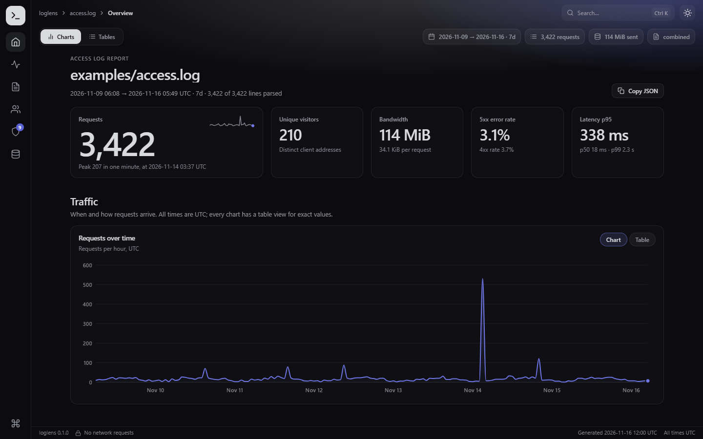
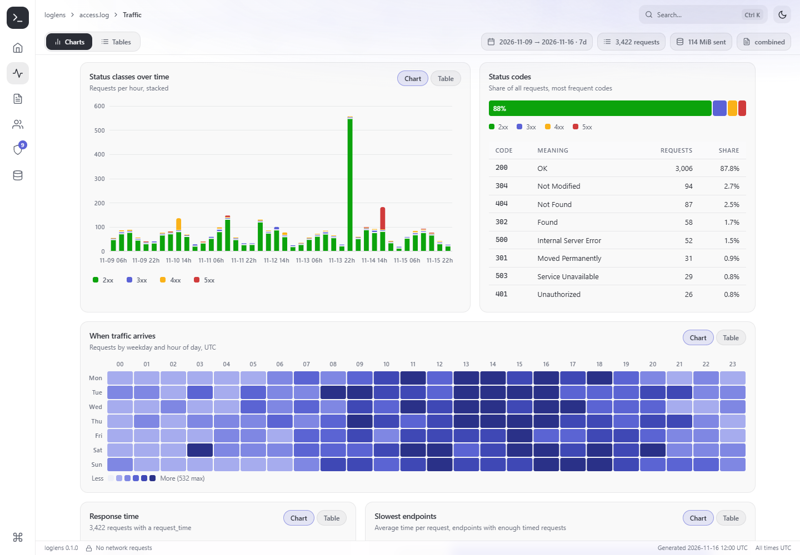
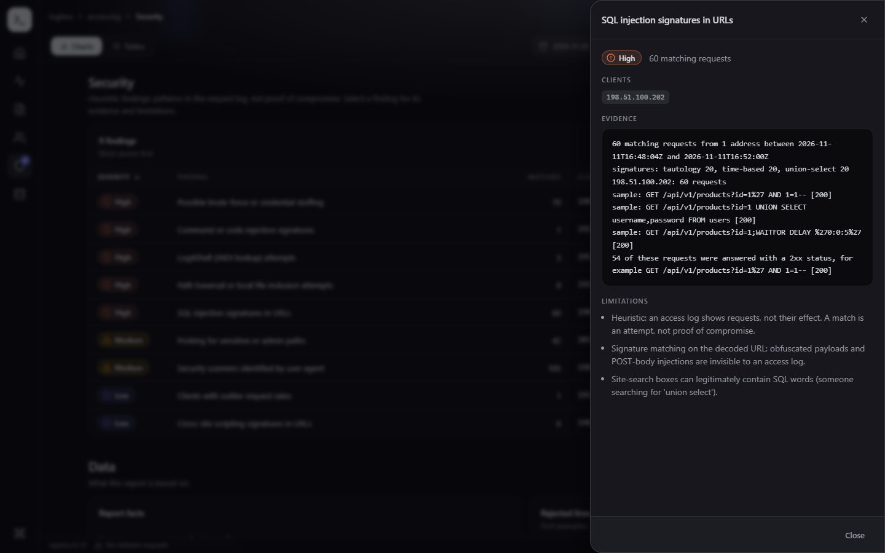
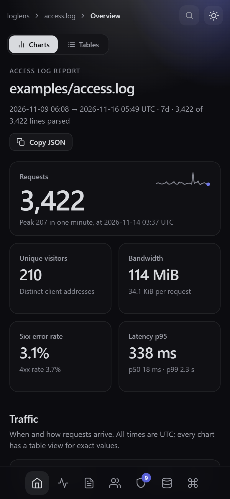
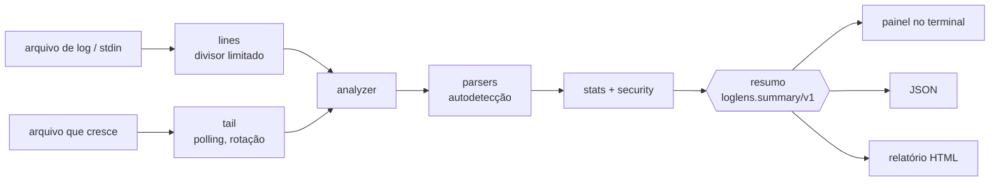

<p align="center">
  
</p>

**O loglens transforma logs de acesso do nginx, Apache e Caddy em um painel ao vivo no terminal, um resumo em JSON e um relatório HTML de arquivo único, em Lua puro e sem dependências.**

[](https://www.lua.org/)
[](LICENSE)
[](#por-que-o-loglens)
[](https://github.com/q6r/loglens/actions/workflows/ci.yml)

[English](README.md) · **Português**



## Por que o loglens

- **Um comando responde "o que está acontecendo no meu servidor".** Aponte para um log e veja tráfego, erros, percentis de latência, quem está pedindo e o que parece hostil. Sem agente, sem banco de dados, sem configuração.
- **Entrada hostil é o caso normal.** O texto do log é escapado antes de chegar a um terminal ou a um navegador, uma linha de 10 GB não esgota a memória, e o uso de memória depende da configuração, não do tamanho do log.
- **Uma análise, três saídas.** Um painel para pessoas, um esquema JSON estável para scripts e portões de CI (`--fail-on high`) e um único arquivo HTML que funciona offline e não faz nenhuma requisição de rede.

## Recursos

- **Formatos:** *combined* e *common* do nginx e do Apache, JSON lines e Caddy v2; detectados automaticamente, tolerando IPv6, aspas escapadas, linhas truncadas e lixo binário ([formatos](docs/formats.md)).
- **Modo ao vivo:** `loglens watch` acompanha um arquivo que cresce (ou a entrada padrão) e redesenha um painel animado em ritmo constante; detecta rotação de logs, ajusta-se à altura do terminal e restaura o terminal ao sair.
- **Números confiáveis:** contadores exatos, sketches Space-Saving para os rankings, visitantes únicos exatos e depois HyperLogLog, séries por minuto e por hora, latência p50/p90/p95/p99 a partir de um histograma de faixas logarítmicas, detecção de picos de 5xx.
- **Heurísticas de segurança com evidências e limites:** sondagem de caminhos, path traversal, SQL injection, XSS, injeção de comandos, Log4Shell, user agents de scanners, força bruta e clientes com taxa de requisições atípica. Cada achado diz o que foi encontrado e o que ele não consegue ver ([heurísticas](docs/security-heuristics.md)).
- **Relatório HTML:** um arquivo offline organizado como um aplicativo (barra lateral de navegação, trilha de navegação, alternância de visões, barra de status) com o kit de interface Aurora incluído no repositório; temas escuro e claro, paleta de comandos, visão em gráfico ou em tabela para cada gráfico, scripts e estilos fixados por SHA-256 em uma Content-Security-Policy.
- **Automatizável:** saída `json` com esquema documentado e determinístico ([esquema](docs/json-output.md)), janela de tempo, `--top`, entrada padrão com `-` e código de saída para CI.

## Início rápido

Você precisa do Lua 5.3 ou 5.4 (`lua -v`). Não há nada para instalar.

```console
git clone https://github.com/q6r/loglens.git
cd loglens
lua spec/run.lua                                   # opcional: a suíte de testes
lua bin/loglens report examples/access.log         # painel no terminal
lua bin/loglens html examples/access.log -o report.html
lua bin/loglens json examples/access.log -o summary.json
lua bin/loglens watch /var/log/nginx/access.log    # ao vivo, Ctrl+C para parar
```

No Windows use `bin\loglens.cmd report examples\access.log` (ou `lua bin\loglens ...`). Com o LuaRocks, `luarocks make` instala o comando `loglens` (veja a observação sobre o rockspec em [Testes](#testes)).

A pasta `examples/` traz uma semana de tráfego sintético de uma loja pequena (com um scanner, uma tentativa de força bruta, tentativas de injeção e uma queda do checkout escondidos no meio) em quatro formatos, o resumo JSON e o relatório HTML gerado a partir dele. Para regenerar: `lua tools/gen_examples.lua`.

## Uso

```
loglens [report] [opções] <arquivo|->...    painel de um log já encerrado (comando padrão)
loglens json     [opções] <arquivo|->...    resumo legível por máquina (esquema loglens.summary/v1)
loglens html     [opções] <arquivo|->...    relatório HTML autocontido (funciona offline)
loglens watch    [opções] <arquivo|->       acompanha um log que cresce e redesenha o painel ao vivo
loglens formats                             lista os formatos de log suportados
loglens version                             mostra a versão
```

A referência completa, com todas as opções e os códigos de saída, está em [docs/usage.md](docs/usage.md). (Os nomes das opções e as mensagens do programa estão em inglês.)

### Painel

```console
$ lua bin/loglens report examples/access.log --top 5 --no-color --width 100
 loglens  examples/access.log · combined · 2026-11-09 06:08 → 2026-11-16 05:49 UTC (7d)

 REQUESTS        BANDWIDTH       VISITORS        AVG RATE        5XX RATE        LATENCY P99
 3,422           113.9 MiB       210             0.01/s          3.1%            2.3 s
 peak 207/min    avg 34.1 KiB    unique IPs      over 7d         4xx 3.7%        p50 18 ms

 TRAFFIC  requests per hour, peak 532/hour at 03:00
 req  ▁▁▂▂▂▂▂▂▁▁▁▁▁▂▂▂▂▂▅▂▁▂▂▁▁▁▂▁▂▂▃▂▆▂▂▁▁▁▁▁▂▁▆▂▂▂▂▂▂▁▁▁▁▁▂▂▂▂▃▁▂▁▁▁▁█▁▂▂▃▃▂▂▂█▁▁▁▁▁▁▂▂▂▂▂▂▂▂▂▁▁▁
 5xx           ▁      ▁         ▁     ▁                                    ▁▁   █          ▁▁
      2026-11-09 06:00                                                             2026-11-16 05:00

 STATUS  ███████████████████████████████████████████▓▓▓▒▒░  2xx 87.8%  3xx 5.3%  4xx 3.7%  5xx 3.1%

 TOP PATHS  requests                               TOP CLIENTS  requests
 /api/v1/products                 ██████████ 753   192.0.2.207                       ██████████ 520
 /                                ████▍      326   198.51.100.2                      ██████▊    351
 ...
 FINDINGS  9 heuristic findings; evidence and limitations in --json
 [HIGH] Possible brute-force or credential stuffing                                             70x
        from 198.51.100.203
 [HIGH] Command or code injection signatures                                                     1x
        from 192.0.2.204  ·  signatures: shell-path 1
 ...
```

A cor é usada quando a saída é um terminal; `--color always`, `--no-color`, `NO_COLOR` e `FORCE_COLOR` a substituem. `--ascii` troca os caracteres de bloco, e `--width` fixa a largura (40 a 240).

### Modo ao vivo

O `loglens watch` lê o que o arquivo já contém e depois o acompanha. O cabeçalho mostra um marcador LIVE animado, um indicador giratório e quantas linhas chegaram no último segundo. Um backlog grande é lido em fatias entre os redesenhos, então os números sobem na tela em vez de o painel congelar; um log rotacionado é retomado do início; quando o painel é mais alto que o terminal, as listas menos importantes saem primeiro.



*Quadros reais do `loglens watch examples/access.log`, do início ao fim do exemplo (para regenerar: `lua tools/make_recording.lua`). A imagem principal no topo é o último quadro, e com movimento reduzido ativado a gravação mostra apenas esse quadro.*

<details>
<summary>Um quadro da mesma execução, mais ou menos um terço adiante</summary>



</details>

`tail -f access.log | loglens watch -` lê a entrada padrão; `--interval`, `--frames N` (para depois de N quadros) e `--new-only` (ignora o que o arquivo já contém) estão na [referência](docs/usage.md#watch-mode).

### JSON e portões de CI

O resumo é determinístico: o mesmo log gera os mesmos bytes, e `SOURCE_DATE_EPOCH` fixa o único carimbo de tempo (`meta.generatedAt`) que seria a hora atual.

```console
$ SOURCE_DATE_EPOCH=1794830400 lua bin/loglens json examples/access.log --top 3
{
  "schema": "loglens.summary/v1",
  "meta": {
    "tool": "loglens",
    "version": "0.1.0",
    "generatedAt": "2026-11-16T12:00:00Z",
    "sources": ["examples/access.log"],
    "format": "combined",
    "autoDetected": true,
    ...
```

`--fail-on SEVERIDADE` sai com status 3 quando um achado atinge essa severidade; o relatório continua sendo escrito:

```console
$ lua bin/loglens json examples/access.log --compact --fail-on high > summary.json
loglens: 5 findings at or above 'high'
$ echo $?
3
```

Erros são explicados, com sugestões:

```console
$ lua bin/loglens report examples/access.log --formt json
loglens: unknown option '--formt'. Did you mean '--format'? (see 'loglens report --help')
$ lua bin/loglens jsn examples/access.log
loglens: unknown command 'jsn'. Did you mean 'json'?
$ lua bin/loglens report nope.log
loglens: nope.log: No such file or directory
```

Códigos de saída: `0` ok, `1` falha (entrada ilegível ou nenhuma linha pôde ser interpretada), `2` erro de uso, `3` `--fail-on`, `130` interrompido.

### Relatório HTML

```console
$ lua bin/loglens html examples/access.log -o report.html
loglens: wrote report.html (253.3 KiB)
```

Um arquivo só, sem servidor, sem rede. Abre direto de `file://` e é organizado como um aplicativo: uma barra lateral com um destino por seção (visão geral, tráfego, conteúdo, clientes, segurança, dados) que acompanha a rolagem, trilha de navegação, uma alternância Gráficos / Tabelas (cada gráfico também tem a sua própria visão em tabela), paleta de comandos (`Ctrl+K`), temas escuro e claro e uma barra de status. No celular a barra lateral vai para o pé da tela. Selecione um achado para ver as evidências e as limitações.



| Tema claro | Um achado com suas evidências | No celular |
|---|---|---|
|  |  |  |

### Como biblioteca

Tudo o que a CLI faz está disponível como módulos Lua simples:

```lua
local analyzer = require("loglens.analyzer")

local summary = analyzer.analyze_lines(io.lines("examples/access.log"), { top = 5 })
print(summary.totals.requests, summary.findings[1].severity, summary.findings[1].title)
--> 3422    high    Possible brute-force or credential stuffing
print(#summary.paths, summary.paths[1].path, summary.paths[1].count)
--> 5       /api/v1/products        753

local page = require("loglens.render.html").render(summary)   -- o relatório HTML como string
```

`analyzer.new(opts)` devolve um objeto com `feed(line)` e `summary()` para uso em fluxo; `summary()` pode ser chamado a qualquer momento. O resultado está documentado em [docs/json-output.md](docs/json-output.md).

## Arquitetura



Os parsers produzem registros, o analisador os agrega em sketches de memória limitada e detectores, e os renderizadores transformam o resumo em texto, JSON ou HTML; eles nunca veem o log. Tudo o que toca o mundo externo (arquivos, relógio, espera, terminal) é passado como argumento, então a CLI e o laço ao vivo são testados com dublês. Detalhes e os limites de memória estão em [docs/architecture.md](docs/architecture.md).

## Estrutura do projeto

```
bin/loglens              ponto de entrada (bin/loglens.cmd no Windows)
src/loglens/
  cli.lua, args.lua      comandos, leitura de opções, código de saída
  watch.lua, tail.lua    laço ao vivo e fontes de arquivo/fluxo
  lines.lua              divisor de linhas com memória limitada
  platform.lua           o único código que toca o SO (terminal, espera, ambiente)
  analyzer.lua           pipeline em fluxo: detectar, interpretar, janela, contar, detectar ataques
  parser/                combined/common, JSON lines, Caddy
  stats.lua, security.lua, agents.lua, topk.lua, hll.lua, histogram.lua
  summary.lua            id do esquema, validador, JSON canônico
  render/terminal.lua    resumo -> texto (função pura)
  render/html.lua        resumo -> relatório de arquivo único
  assets/                kit de interface Aurora (aurora*.css/js) + report.js/report.css
spec/                    especificações (globais não declaradas são erro), quadros golden em spec/fixtures/golden
tools/                   loggen.lua (logs sintéticos), gen_examples.lua, make_recording.lua
examples/                logs de exemplo, summary.json, report.html
docs/                    arquitetura, formatos, heurísticas de segurança, json-output, uso, screenshots
```

## Configuração

Opções da linha de comando (todas em [docs/usage.md](docs/usage.md)):

| Opção | Padrão | Significado |
|---|---|---|
| `-f, --format` | `auto` | `combined`, `common`, `json` ou `caddy` |
| `--from`, `--to` | nenhum | janela de tempo, ISO 8601 ou segundos desde a época |
| `-n, --top` | `10` | linhas por ranking (1 a 100) |
| `--color`, `--no-color`, `--ascii`, `--width` | automático | aparência no terminal |
| `-o, --output`, `--compact` | stdout | onde e como `json` e `html` escrevem |
| `--fail-on` | desligado | sai com status 3 nesta severidade ou acima |
| `--interval`, `--frames`, `--new-only` | `0.25`, sem fim, desligado | modo watch |

| Ambiente | Efeito |
|---|---|
| `NO_COLOR`, `FORCE_COLOR`, `TERM=dumb` | liga ou desliga a cor |
| `COLUMNS`, `LINES` | tamanho do terminal, quando o shell o exporta |
| `SOURCE_DATE_EPOCH` | fixa `meta.generatedAt` para saída reproduzível |
| `LOGLENS_DEBUG` | stack trace para erros inesperados |

Opções de biblioteca de `analyzer.new`: `format` (`"auto"`), `top` (10), `from`, `to`, `sources`, `now`, `max_line_bytes` (65.536), `malformed_samples` (5), `detect_lines` (10), além das tabelas `stats` (capacidades, número de faixas, precisão) e `security` (limiares, veja as [heurísticas](docs/security-heuristics.md#thresholds)).

## Notas de segurança

- **Logs não são confiáveis.** Caminhos, user agents e linhas de evidência passam por `util.defang`: caracteres de controle, UTF-8 inválido e pontos de código bidirecionais ou invisíveis são escritos como `\xNN` ou `\uXXXX`, e `< > " ' ` $ { } \` são codificados com porcentagem. Uma requisição hostil não consegue injetar sequências de terminal, marcação ou sintaxe de shell em um relatório.
- **O conteúdo do log não consegue sequestrar o relatório HTML.** Os dados viajam em uma ilha JSON com `<`, `>`, `&`, U+2028 e U+2029 escapados, cada texto é desenhado com `textContent`, e uma `Content-Security-Policy` (`default-src 'none'`, scripts e estilos fixados por SHA-256) impede que marcação injetada execute ou alcance a rede. Os testes passam `</script>` e U+2028 pelo renderizador.
- **Recursos limitados.** Uma linha é limitada a 64 KiB enquanto é lida (a única exceção é `watch -`, que lê a entrada padrão linha a linha), rankings e estado por cliente vivem em sketches de tamanho fixo, as séries guardam um número fixo de faixas e `--output` se recusa a sobrescrever a própria entrada.
- **Nada é executado e nada sai da máquina.** O loglens não faz requisições de rede, escreve apenas o arquivo que você indicar e nunca avalia o conteúdo do log. Seus únicos subprocessos são `sleep`, `stty` e `[ -t 1 ]` (POSIX) ou `mode con` (Windows), usados para tratar o terminal e protegidos para que uma falha volte aos padrões.
- **Achados são heurísticas.** Eles relatam tentativas, não invasões, e cada um declara suas limitações. Uma resposta 2xx a um ataque não prova que ele funcionou.

Relate vulnerabilidades de forma privada, como descrito em [SECURITY.md](SECURITY.md).

## Testes

```console
$ lua spec/run.lua
loglens spec runner (Lua 5.4)
...
390 tests, 90481 assertions, 0 failures
```

Parsers, sketches e o codec JSON têm testes de propriedade e de fuzzing com geradores com semente; os quadros do terminal são comparados com arquivos golden (`UPDATE_GOLDEN=1 lua spec/run.lua` os reescreve: leia a diferença); a CLI, o laço watch, a rotação de logs, as decisões de cor e largura e o escape do HTML rodam contra arquivos, relógios e terminais falsos. O CI está configurado para rodar a suíte no Lua 5.3 e 5.4, o luacheck, um teste de fumaça dos comandos e uma verificação de que os exemplos versionados estão atualizados.

O que as especificações não cobrem sozinhas: leitura de um terminal real (tamanho, isatty), um `tail -f` de verdade contra outro processo, consoles do Windows e a instalação com o LuaRocks (o rockspec está escrito, mas não foi construído onde isto foi desenvolvido). Esses caminhos ficam atrás de pequenos ganchos (`platform.lua`) que os testes substituem por dublês.

## Roteiro

- Logs compactados (`.gz`) sem precisar do `zcat`.
- Mais formatos: HAProxy, Traefik, balanceadores da AWS.
- `--anonymize` para gerar hash dos endereços de clientes em relatórios compartilhados.
- Comparar dois períodos e uma exportação no estilo Prometheus.
- Controle por teclado no modo watch (pausar, ordenar, abrir um achado) onde houver terminal não bloqueante.

## Contribuindo

Issues e pull requests são bem-vindos. O [CONTRIBUTING.md](CONTRIBUTING.md) cobre a preparação do ambiente, a suíte de testes, o lint e o estilo de commits.

## Licença

[MIT](LICENSE) © 2026 q6r

## Créditos

O relatório HTML é construído com o kit de interface Aurora, incluído em `src/loglens/assets/` (sem dependências, MIT, parte deste repositório). Os sketches seguem o algoritmo Space-Saving (Metwally, Agrawal e El Abbadi) e o HyperLogLog (Flajolet e outros); os valores atípicos usam o z-score modificado de Iglewicz e Hoaglin. O [GoAccess](https://goaccess.io/) é a ferramenta consolidada neste campo e uma ótima referência: o loglens é independente e mais estreito, voltado a um painel sem instalação, um resumo automatizável e uma triagem de segurança.
