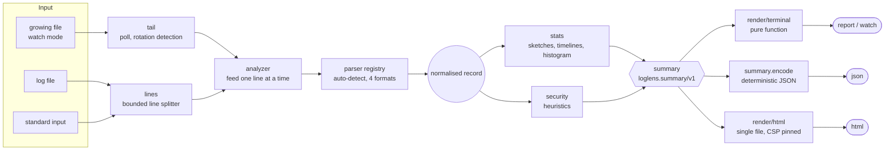

# Architecture

loglens is a pipeline of small modules around one data structure, the **summary**
(`loglens.summary/v1`, see [json-output.md](json-output.md)). Everything that reads a log
produces a summary; everything that shows results consumes one. The two never touch.



## Modules

| Module | Responsibility |
|---|---|
| `loglens.cli`, `loglens.args` | Argument parsing, the commands, exit status. `main(argv, env)` returns a status and never exits. |
| `loglens.platform` | The only code that touches the operating system: standard streams, environment, sleep, terminal size. Everything else receives it as the `env` table. |
| `loglens.lines` | Splits a byte stream into lines in fixed-size chunks; a line is kept up to `max_line_bytes`, the rest is discarded unread. |
| `loglens.tail` | Sources for watch mode: a file followed by polling (no handle stays open) and a line-by-line stream. |
| `loglens.watch` | The live loop: poll, feed, draw, sleep. Clock, sleep, terminal and output are hooks. |
| `loglens.analyzer` | The streaming pipeline: format detection, parsing, time window, statistics, findings; `summary()` can be called at any time. |
| `loglens.parser.*` | One parser per format. All produce the same normalised record (`parser.entry`). |
| `loglens.stats` | Counters, Space-Saving sketches, HyperLogLog, minute and hour timelines, latency histogram. |
| `loglens.security`, `loglens.agents` | Attack-signature and behaviour heuristics; user-agent classification. |
| `loglens.summary` | The schema id, canonical key order, JSON encoding and a validator. |
| `loglens.render.terminal` | `render(summary, opts)`: a pure function from summary to text. |
| `loglens.render.html` | `render(summary)`: the bundled Aurora UI kit, the report view and the data in one document. |
| `loglens.sha256` | SHA-256 and Base64, used to pin inline code in the report's Content-Security-Policy. |
| `loglens.json`, `loglens.time`, `loglens.util` | Strict JSON (decoder and encoder), calendar arithmetic without `os.date`, text helpers. |

## Bounded memory

Memory depends on configuration, never on the size of the log or the number of distinct values in it.

| What | Structure | Bound |
|---|---|---|
| Top paths, clients, referrers, user agents, 404 and 5xx paths | Space-Saving sketch (`topk`) | `capacity` keys each (1,000); counts carry an `overcount` bound |
| Unique visitors | exact set, then HyperLogLog (`hll`) | exact up to 10,000, then 4,096 registers (about 1.6 % error) |
| Requests over time | per-minute and per-hour buckets | the most recent 10,080 minutes and 8,760 hours; the summary exposes 1,440 and 720 points |
| Latency percentiles | logarithmic-bucket histogram (`histogram`) | fixed number of buckets, 1 % relative accuracy |
| Per-client security state | Space-Saving sketches | 512 clients per heuristic |
| One line of input | `lines` splitter | `max_line_bytes` (65,536); longer lines are counted as malformed (not enforced while reading in `watch -`) |
| Malformed lines | counter plus samples | 5 samples, 160 bytes each |

## Live mode

```mermaid
sequenceDiagram
  participant Loop as watch.run
  participant Src as tail source
  participant An as analyzer
  participant Ren as terminal.render
  participant Out as write hook
  loop every interval
    Loop->>Src: poll(emit, keep_going)
    Src-->>An: lines (within the time budget)
    Src-->>Loop: status tailing, rotated or waiting
    Loop->>An: summary()
    Loop->>Ren: render(summary, width, frame, live, max_lines)
    Ren-->>Loop: text
    Loop->>Out: cursor home + text
    Loop->>Loop: sleep(rest of the interval)
  end
```

* A poll always reads at least one chunk but stops when the frame's time budget is spent, so a
  large backlog fills the dashboard progressively instead of freezing it.
* The file is opened, read and closed on every poll. No handle is kept, so rotation or deletion by
  another program is never blocked (this matters on Windows). A file counts as replaced when it
  is smaller than what was already read, when its first 64 bytes changed, or when it disappeared
  and came back.
* The terminal height is respected: when the frame is taller than the terminal the least
  important sections go first (404 and 5xx paths, then referrers and agents, then slowest
  endpoints and spikes, then paths and clients); key figures, status, traffic and findings are
  kept as long as possible.
* The terminal is restored (cursor, alternate screen) when the loop ends, fails or is interrupted.

## Injectable I/O

`cli.main(argv, env)`, `watch.run(opts, hooks)` and `platform.new(system)` take the outside world
as arguments. The specs hand them an in-memory file system, fake clocks and fake terminals
(`spec/fakes.lua`), so the CLI, the watch loop, rotation handling and colour or width decisions
run deterministically and fast. Plain Lua has no isatty, no terminal size and no sleep, so those
three come from `platform` (see the notes there and in the README).

## Output safety

* Everything that came from a log (paths, addresses, user agents, evidence samples) reaches the
  terminal through `util.defang`: control characters, invalid UTF-8 and invisible or bidirectional
  code points are written as `\xNN` or `\uXXXX`, and characters that could become markup, shell or
  JNDI syntax are percent-encoded.
* The HTML report embeds the summary as a JSON island. `<`, `>`, `&`, U+2028 and U+2029 are
  written as `\u003c`, `\u003e`, `\u0026`, `\u2028`, `\u2029`, so no log content can close the
  script element. The view code draws every string with `textContent`.
* A `Content-Security-Policy` meta tag (`default-src 'none'`, scripts and styles pinned by SHA-256)
  means that even injected markup could neither run nor reach the network.
* Nothing in the log is ever executed or evaluated.

## Determinism

`summary.encode` writes keys in a fixed order and the analyzer sorts every list with explicit
tie-breakers, so one log always gives the same bytes (only `meta.generatedAt` changes; set
`SOURCE_DATE_EPOCH` to fix it). `tools/gen_examples.lua` uses this to regenerate `examples/`, and CI
checks that the committed files are current.

## Bundled UI kit and the report page

`src/loglens/assets/` holds the front end of the HTML report: `aurora.css`, `aurora.js` and
`aurora-charts.js` are the Aurora UI kit (zero dependencies, MIT, part of this repository), and
`report.js` and `report.css` are this project's view of the summary. `render/html.lua` reads the
five files relative to itself, inlines them next to the data and pins them in the
Content-Security-Policy.

The document itself is almost empty: a `<noscript>` fallback (the plain-text dashboard), the JSON
island and the scripts. `report.js` builds the page with `Aurora.shell`:

| Part | What the report puts there |
|---|---|
| Rail | one destination per section (Overview, Traffic, Content, Clients, Security with the number of findings, Data) that follows the scroll, and the command palette |
| Top bar | breadcrumbs `loglens > file > section`, the search button (the palette) and the theme toggle |
| Sub bar | a Charts / Tables switch that flips every chart card between its chart and its table view, and pills for the period, the requests, the bytes sent and the log format |
| Status bar | the loglens version, "No network requests" and when the report was generated |

A log without requests only gets the Overview and Data sections.

## Supported Lua versions

Lua 5.3 and 5.4. The code uses 64-bit integers, bit operators, integer division, `utf8` and
`string.pack`, so LuaJIT (Lua 5.1 semantics) is not supported.
